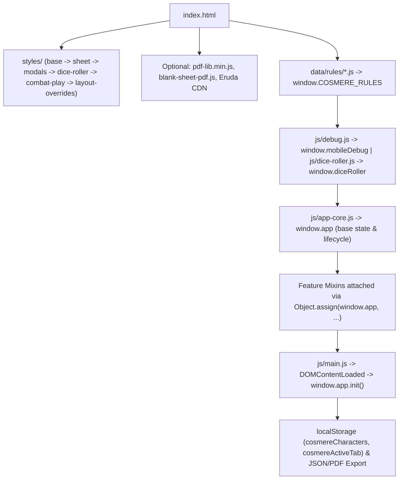

# Architecture

This document describes the modular structure, runtime load order, state schemas, and module boundaries of the Cosmere RPG Character Sheet.

## Design Philosophy

- **Single-entry, zero-build browser app**: Double-clicking `index.html` opens the entire app over `file://` with no build step, server, or framework.
- **Namespace / Mixin Modularity**: Because browsers enforce strict CORS restrictions on ES modules and `fetch()` over `file://`, scripts are loaded as ordered classic `<script src="...">` tags. Each file wraps its internals in an IIFE `(function () { ... })();` and attaches public methods to `window.app` via `Object.assign(window.app, { ... })`.
- **Strict Separation of Data, Markup, Styles, and Logic**:
  - `index.html` holds DOM structure and asset loading only.
  - `data/rules/*.js` holds game rules data (`window.COSMERE_RULES`).
  - `styles/*.css` holds styling split by concern and ordered for cascade specificity.
  - `js/*.js` holds application behavior split by domain.

## Runtime Load Order & Data Flow

## Module Catalog

### Rules Data (`data/rules/`)

All files assign top-level keys onto `window.COSMERE_RULES`:

- `data/rules/core.js` — `version`, `gameName`, `maxLevel`, `attributes`, `skills`, `defenses`, `resources`, `movement`, `senses`, `lifting`, `advancement`, `ancestries`, `ancestryPaths`, `cultures`, `conditions`.
- `data/rules/heroic-paths.js` — `heroicPaths` (6 heroic paths, specialties, key talents, and talent trees with `prerequisite` / `requiresTalent` / `effects`).
- `data/rules/radiant-orders.js` — `radiantOrders` (10 Radiant Orders, associated surges, ideals, and order talents).
- `data/rules/surges.js` — `surges` (10 Surges, linked attributes, and surge talent trees).
- `data/rules/expertises.js` — `expertises` (categorized catalog: `armor`, `weapon`, `cultural`, `utility`, `specialist` plus mechanical `effects`).
- `data/rules/equipment.js` — `itemTraitGlossary`, `weapons`, `armor`, `currency`, `equipment`, `startingKits`.
- `data/rules/index.js` — Startup sanity check verifying all 25 required top-level keys are present on `window.COSMERE_RULES`.

### Stylesheets (`styles/`)

Loaded in strict order inside `<head>`:

1. `styles/base.css` — CSS custom properties (`:root`), reset, typography, `.container`, `header`, `.header-controls`, `.pdf-export-control`, buttons, `.character-list`, `.character-card`, `.sheet-container`, `.input-group`, `.hidden`.
2. `styles/sheet.css` — `.stats-grid`, `.stat-column`, attributes/defenses/skills/resources, paths/talents, expertises, tooltips, validation banners, point trackers, equipment/inventory/currency, portraits, injuries/conditions/connections.
3. `styles/modals.css` — `.modal` shell, `.app-dialog-*` shared dialog/form styles, `.expertise-tab`/`.expertise-option`, `.weapon-selection-list`/`.weapon-option`, `.portrait-lightbox`.
4. `styles/dice-roller.css` — `.dice-controls`, `.dice-toggle`, `.dice-fab`, `.dice-roller-modal`, `.dice-grid`, `.roll-result`, `.roll-history`, `.plot-die-*`, `.inline-dice-btn`, `.roll-toast` and toast keyframes.
5. `styles/combat-play.css` — `.combat-play-section`, `.play-grid`, `.play-card`, `.play-dice-btn`, `.collapsible-section`, `.action-list`, tablet responsive rules.
6. `styles/layout-overrides.css` — Universal `.section-header`/`.section-content`, `.tab-bar`/`.tab-button`/`.tab-pane`, `@media print`, and `@media (max-width: 768px)` mobile overrides. **Must remain last** so tab flattening, print rules, and mobile overrides win the cascade.

### JavaScript Modules (`js/`)

Loaded in strict order at the end of `<body>`:

1. `js/debug.js`
   - Owns: `window.mobileDebug`, `window.erudaInitialized`, `window.onerror`, `window.onunhandledrejection`.
   - Notes: Guards `typeof eruda !== 'undefined'` so offline `file://` usage never throws when the Eruda CDN is unreachable.
2. `js/dice-roller.js`
   - Owns: `window.diceRoller` (Advantage/Disadvantage/Plot Die toggles, dice notation parser, modal roller, inline rolling, toast notifications, roll history, quick skill rolls) and global `keydown` shortcuts (`D` opens roller when no dialog/input is active, `Escape` closes open modals and portrait lightbox).
   - Reads: `app.currentCharacter` and `app.rules` when rendering quick skill rolls.
3. `js/app-core.js`
   - Owns: `window.app` base state (`rules`, `characters`, `currentCharacter`), lifecycle (`init`, `loadRules`), character CRUD (`createNewCharacter`, `loadCharacter`, `deleteCurrentCharacter`), list & core sheet rendering (`renderCharacterList`, `renderCharacterSheet`, `renderSkills`), input handlers (`updateSkill`, `updateAttributeValue`, `updateCharacter`), and `escapeHtml`.
4. `js/dialogs.js`
   - Owns: `window.app.dialog` — centralized, queued, Promise-based in-app dialog system (`alert`, `confirm`, `prompt`, `form`, `isOpen`) backed by `#appDialog`, replacing all native `alert()`/`confirm()`/`prompt()` calls.
5. `js/rules-engine.js`
   - Owns: Handbook derived-stat calculators (`computeMaxHealth`, `computeTalentMaxHealthBonus`, `computeMaxFocus`, `computeSensesRange`, `computeMovementRate`, `computeMaxInvestiture`, `computeAttributeBudget`, `computeSkillRankBudget`, `computeExpertiseBudget`, `getMaxAttributeAtCurrentLevel`, `getCurrentTier`, `getMaxSkillRankAtCurrentLevel`), culture/grant helpers (`getCultureData`, `resolveGrantedExpertise`, `getAutoGrantedExpertises`), schema migration & cleanup (`migrateCharacterShape`, `cascadeCleanup`, `maybeShowRulesUpdateNotice`), and master recalculation/validation (`recalculateAll`, `updatePointTrackers`, `validateCharacter`, `renderValidationSummary`).
6. `js/paths-talents.js`
   - Owns: Heroic Paths, Radiant Orders, Ancestry Path auto-sync (`syncAncestryPath`), Surges (`renderSurges`, `changeSurgeRank`, `toggleSurgeTalent`), Path & Talent Tree rendering (`computeTalentTiers`, `renderTalentTree`, `renderTalentCard`), path CRUD (`addPath`, `changePathLevel`, `removePath`, `getTotalLevel`), and the talent prerequisite engine (`buildTalentIndex`, `evaluateRequiresTalent`, `checkTalentPrerequisite`, `evaluatePrereqClause`, `toggleTalent`, `findDependentTalents`).
7. `js/expertises.js`
   - Owns: Expertise reconciliation (`reconcileExpertises`), list/tracker rendering, expertise budget breakdown, and the categorized searchable Expertise Picker Modal (`openExpertiseModal`, `selectExpertiseTab`, `filterExpertises`, `commitCatalogExpertise`, `commitCustomExpertise`, `removeExpertise`).
8. `js/equipment.js`
   - Owns: Unified inventory & equipment migration (`migrateEquipmentData`, `syncEquippedFromInventory`), expertise-to-item trait modifiers (`applyExpertiseToItem`, `canonicalWeaponView`, `canonicalArmorView`), weapon/armor/item picker modals, custom item creation, inventory item editing (`editInventoryItem`, `editWeaponItem`, `editArmorItem`, `editGeneralItem`), equip/unequip flows, starting kits (`selectStartingKit`, `applyKitToInventory`), combat bonuses (`calculateAttackBonuses`, `calculateInitiative`), inventory rendering, and sphere currency (`renderCurrency`, `updateCurrency`).
9. `js/character-details.js`
   - Owns: Injuries, conditions (including searchable Condition Picker Modal), connections, goals & 3-step milestone checkboxes, languages (known Roshar languages + custom languages), and portrait upload/canvas resizing (`MAX_SIZE = 512` JPEG data URL) + lightbox.
10. `js/combat-play.js`
    - Owns: 5-tab navigation (`identity`, `stats`, `combat`, `paths`, `story`) persisted to `localStorage`, legacy no-op `toggleSection`, and the tablet-optimized Combat & Play panel (`toggleCombatPlay`, `updateCombatPlayDisplay`, `renderPlaySkills`, `renderPlayWeapons`).
11. `js/storage.js`
    - Owns: `localStorage` persistence (`saveToLocalStorage`, `loadFromLocalStorage`), `downloadBytes`, and JSON character file import/export (`exportToFile`, `importFromFile`, `handleFileImport`).
12. `js/pdf-export.js`
    - Owns: Official blank-sheet AcroForm field mappings (`pdfSkillRows`, `pdfCustomSlots`, `pdfGoalBoxes`, `pdfAttrAbbr`), `PDFLib`-powered `fillBlankSheet` (using embedded `window.BLANK_SHEET_PDF_BASE64` from `blank-sheet-pdf.js` or file picker fallback), `buildSimplifiedSheet` (programmatic 2-page PDF), and `exportToPdf`.
13. `js/main.js`
    - Owns: `DOMContentLoaded` bootstrap calling `window.app.init()`.

## Character Data Schema (`currentCharacter`)

Each entry in `app.characters` (serialized to `localStorage`) has the following shape:

- Identity: `id`, `name`, `playerName`, `ancestry`, `culture`, `createdAt`, `updatedAt`
- Core Stats:
  - `attributes`: `{ strength, speed, intellect, willpower, awareness, presence }`
  - `skills`: `{ [skillId]: rank }` (18 core skills)
- Derived / Tracked Resources (computed in `recalculateAll()`):
  - `maxHealth`, `currentHealth`, `maxFocus`, `currentFocus`, `maxInvestiture`, `currentInvestiture`
  - `physicalDefense`, `cognitiveDefense`, `spiritualDefense`, `deflect`, `recoveryDie`, `movement`, `sensesRange`, `liftingCapacity`
- Progression:
  - `paths`: Array of `{ id, type, level }` (`type`: `'heroic' | 'radiant' | 'ancestry'`)
  - `talents`: Array of full talent IDs (`<pathId>_<localId>`)
  - `surgeRanks`: `{ [surgeId]: rank }`
  - `surgeTalents`: Array of full surge talent IDs (`surge_<surgeId>_<localId>`)
  - `expertises`: Array of `{ id?, name, category?, source }`
  - `grants`: Array of `{ source, type, payload }` used by `cascadeCleanup()`
- Equipment & Combat:
  - `startingKit`, `weapons` (synced mirror of equipped weapons), `equippedArmor` (synced mirror), `inventory` (unified array of items/weapons/armor with `quantity`, unit `weight`, unit `price`, and `equipped` flag), `currency` (`{ chips, marks, broams }`)
- Narrative & Status:
  - `purpose`, `obstacle`, `goals` (`[{ text, milestones: [bool, bool, bool] }]`), `notes`
  - `injuries`: `{ temporary: string[], permanent: string[] }`
  - `conditions`: Array of condition objects
  - `connections`: Array of `{ name, relationship, description }`
  - `languages`: Array of language strings
  - `portrait`: JPEG Data URL or `null`
  - `characterDetails`: `{ age, gender, height, weight, appearance, backstory }`
- Export Preferences:
  - `pdfOptions`: `{ pageSize: 'a4' | 'a5', compactTalents: string[] }` (simplified PDF portrait page size and lowercase names of talents exported as name-only)

## Browser Persistence Keys (`localStorage`)

- `cosmereCharacters` — JSON array of all saved characters (`js/storage.js`).
- `cosmereActiveTab` — Last active sheet tab ID: `'identity' | 'stats' | 'combat' | 'paths' | 'story'` (`js/combat-play.js`).
- `cosmereRulesNoticeShown_v3` — One-time flag suppressing the rules-update notice banner (`js/rules-engine.js`).

## Optional External Assets

- `pdf-lib.min.js` — Provides global `PDFLib` for PDF export (`js/pdf-export.js`). If omitted, PDF export alerts cleanly and the rest of the app works normally.
- `blank-sheet-pdf.js` — Provides `window.BLANK_SHEET_PDF_BASE64` for zero-CORS blank sheet PDF filling. If omitted, `js/pdf-export.js` falls back to fetching `blank_sheet.pdf` or prompting the user to pick a file.
- `https://cdn.jsdelivr.net/npm/eruda` — Optional mobile console loaded in `<head>` and guarded in `js/debug.js`.
